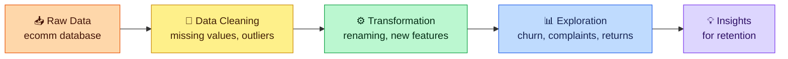

**Finding out why customers leave, and where the friction is.**

👉 **[Read the project documentation (PDF)](./ECommerce_Customer_Churn_Analysis_Project_Documentation.pdf)**

---

## 📌 Executive Summary

In e-commerce, understanding why customers leave is key to staying profitable and keeping long-term relationships. Retaining existing customers costs far less than acquiring new ones.

This project explores transactional and behavioural data from the `ecomm` database to look at churn patterns, find where the service causes friction, and suggest where retention efforts should go.

---

## 🧾 Project at a Glance

| | |
|---|---|
| 👩‍💻 **Author** | Ansania Salam |
| 🛒 **Domain** | E-Commerce / Customer Analytics |
| 🗄️ **Database** | MySQL / RDBMS (`ecomm` database) |
| 🔧 **Core work** | Data Cleaning · Feature Engineering · Exploratory Data Analysis (EDA) · Relational Joins |

---

## 🗺️ Project Flow

---

## 📂 Repository Structure

| File | What's inside |
|------|---------------|
| 📝 [01_ecomm_data.sql](./01_ecomm_data.sql) | Database creation, raw data insertion, missing value imputation, outlier handling and schema changes |
| 🔎 [02_ecomm_data_exploration.sql](./02_ecomm_d
