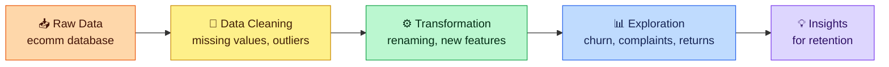

<div align="center">


**Finding out why customers leave, and where the friction is.**

👉 **[Read the project documentation (PDF)](./docs/ECommerce_Customer_Churn_Analysis_Project_Documentation.pdf)**

</div>

---

## 📌 Executive Summary

In e-commerce, understanding why customers leave is key to staying profitable and keeping long-term relationships. Retaining existing customers costs far less than acquiring new ones.

This project explores transactional and behavioural data from the `ecomm` database to look at churn patterns, find where the service causes friction, and suggest where retention efforts should go.

---

## 🧾 Project at a Glance

| | |
|---|---|
| 👩‍💻 **Author** | Ansania Salam |
| 🛒 **Domain** | E-Commerce / Customer Analytics |
| 🗄️ **Database** | MySQL / RDBMS (`ecomm` database) |
| 🔧 **Core work** | Data Cleaning · Feature Engineering · Exploratory Data Analysis (EDA) · Relational Joins |

---

## 🗺️ Project Flow



---

## 📂 Repository Structure

| File | What's inside |
|------|---------------|
| 📝 [01_ecomm_data.sql](./01_ecomm_data.sql) | Database creation, raw data insertion, missing value imputation, outlier handling and schema changes |
| 🔎 [02_ecomm_data_exploration.sql](./02_ecomm_data_exploration.sql) | Exploratory queries, behaviour metrics, returns logging and relational joins |
| 📄 [Project Documentation (PDF)](./docs/ECommerce_Customer_Churn_Analysis_Project_Documentation.pdf) | Complete project overview and analysis details |

---

## 🛠️ Implementation Workflow

### 1. Data Cleaning 🧹

**Missing value imputation**

| Method | Columns |
|--------|---------|
| Rounded mean (continuous) | `WarehouseToHome`, `HourSpendOnApp`, `OrderAmountHikeFromlastYear`, `DaySinceLastOrder` |
| Mode (discrete) | `Tenure`, `CouponUsed`, `OrderCount` |

**Outlier removal:** records with a `WarehouseToHome` distance greater than 100 km were removed.

**Categorical standardisation**

| Original value | Standardised to |
|----------------|-----------------|
| `Phone`, `Mobile` | `Mobile Phone` (login device and category columns) |
| `COD` | `Cash on Delivery` |
| `CC` | `Credit Card` |

### 2. Data Transformation ⚙️

| Task | What was done |
|------|---------------|
| **Column renaming** | `PreferedOrderCat` → `PreferredOrderCat`, `HourSpendOnApp` → `HoursSpentOnApp` |
| **New feature** | `ComplaintReceived` (`Yes` / `No`) created from the binary `Complain` flag |
| **New feature** | `ChurnStatus` (`Churned` / `Active`) created from the binary `Churn` flag |
| **Schema clean-up** | Dropped the old `Churn` and `Complain` columns |

### 3. Data Exploration & Analytical Findings 📊

| Area | What was looked at |
|------|--------------------|
| 📉 **Attrition baseline** | Breakdown of churned and active customers |
| 😟 **Service friction** | Percentage of churned customers who had registered a complaint |
| 🛍️ **Category breakdown** | High-risk product categories (for example *Laptop & Accessory* and *Mobile Phone*) across city tiers and demographics |
| 🚚 **Warehouse distance** | Customers grouped from `Very Close Distance` (5 km or less) to `Far Distance` (over 15 km), with churn checked in each group |
| 🔁 **Post-purchase behaviour** | `customer_returns` joined with customer profiles to see return patterns among churned and complaining customers |

---

## 🎯 Skills Shown in This Project

| Area | What it covers |
|------|----------------|
| **Data cleaning** | Imputation with mean and mode, outlier removal, standardising categories |
| **Feature engineering** | Turning binary flags into readable status columns |
| **SQL analysis** | Aggregation, grouping, segmentation and relational joins |
| **Business thinking** | Linking churn to complaints, product categories, distance and returns |

---

## 🚀 Getting Started

**You need:** MySQL Server 8.0+ or MySQL Workbench.

```bash
git clone https://github.com/AnsaniaSalam/ecommerce-customer-churn-analysis.git
cd ecommerce-customer-churn-analysis
mysql -u root -p < 01_ecomm_data.sql
mysql -u root -p < 02_ecomm_data_exploration.sql
```

Run the files in this order. The first one builds and cleans the data, and the second one explores it.

---

## 👤 Author

**Ansania Salam**

[](https://www.linkedin.com/in/ansania-salam)
[](https://github.com/AnsaniaSalam)

---

## ⚖️ License

This project is licensed under the **MIT License**. See the [LICENSE](./LICENSE) file for details.


